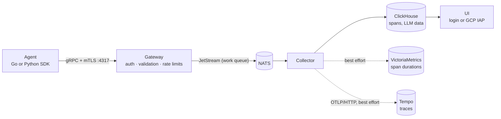

<p align="center">
  
</p>

<h1 align="center">Conduit</h1>

<p align="center">
  <strong>Secure, self-hosted observability for AI agents.</strong><br>
  Trace every agent step, tool call and LLM call. Built with Go, with no npm, no JVM and no supply-chain surprises.
</p>

<p align="center">
  <a href="https://github.com/tjscanlan/conduit/actions/workflows/ci.yml"></a>
  <a href="https://tjscanlan.github.io/conduit/"></a>
  
  
</p>

---

Conduit collects traces from AI agents. Each trace is a run broken into spans for planning, tool calls and LLM calls, with status, errors, token counts and cost. Conduit stores the traces and shows them in a fast, server-rendered UI. It's designed for teams that want agent telemetry inside their own infrastructure, with a small and auditable attack surface.

## Highlights

- **Identity you can trust.** Agents authenticate with mTLS client certificates, and the certificate's CommonName is the agent's identity. An agent can't spoof it with an attribute.
- **Hardened ingestion.** Every span is validated before it reaches storage. Rate limits apply per agent and per telemetry item, so batching can't get around them.
- **LLM-aware traces.** Model, tokens, cost and errors are recorded per span and rolled up per trace. Prompts and completions are stored separately from span metadata.
- **A UI that's quick to read.** One row per trace, filtering by time, agent and errors, stable paging, and a span tree with a waterfall timeline.
- **Small and auditable.** Each service is a static Go binary in a `FROM scratch` image. The UI uses no JavaScript framework, has a strict Content-Security-Policy, and embeds its own assets.
- **Production basics included.** UI sign-in with a login form or Google Cloud IAP, health and readiness endpoints, Kubernetes manifests, and a CI pipeline that runs the whole stack end to end.

## How it works



The gateway accepts spans only from agents holding a certificate signed by your CA. The collector writes each span to ClickHouse, the system of record, and redelivers it if that write fails. It also copies spans to VictoriaMetrics and Tempo on a best-effort basis. The UI reads from ClickHouse. See [Architecture](docs/architecture.md) for details.

## Quick start

You need Docker with Compose, plus Go 1.26 or newer for the helper commands.

```bash
# 1. Certificates: a dev CA, the gateway's server cert, and an example agent cert
./scripts/gen-certs.sh

# 2. A UI login
printf '%s' 'choose-a-long-password' | go run ./cmd/ui hash-password \
  | sed 's/^/admin:/' > deployments/docker/ui-users

# 3. Start the stack
export CLICKHOUSE_PASSWORD=$(openssl rand -hex 16)
docker compose -f deployments/docker/docker-compose.yml up --build --wait
```

Open <http://localhost:8080> and sign in as `admin`. To send your first trace:

```bash
cd sdk/go && go run ./examples/smoke-agent \
  -cert ../../certs/agent-example.crt -key ../../certs/agent-example.key -ca ../../certs/ca.crt
```

To instrument your own agent, see the [Go SDK](docs/sdk-go.md) and [Python SDK](docs/sdk-python.md) guides.

## Documentation

**Read the docs at <https://tjscanlan.github.io/conduit/>**, including the [visual roadmap](https://tjscanlan.github.io/conduit/roadmap.html). The same pages are in [`docs/`](docs/).

**For AI agents:**
- [`llms.txt`](https://tjscanlan.github.io/conduit/llms.txt) indexes the docs and links each page's raw Markdown.
- [`llms-full.txt`](https://tjscanlan.github.io/conduit/llms-full.txt) has all the docs in one file.
- [`AGENTS.md`](AGENTS.md) tells coding agents how to build, test and change this repo.

| Guide | What's in it |
|-------|--------------|
| [Architecture](docs/architecture.md) | Components, data flow, delivery guarantees and storage schema |
| [Security](docs/security.md) | The threat model, mTLS identity, rate limiting, UI authentication and browser hardening |
| [Deployment](docs/deployment.md) | Docker Compose, Kubernetes, health checks, upgrades and configuration reference |
| [Go SDK](docs/sdk-go.md) · [Python SDK](docs/sdk-python.md) | Instrumenting agents |
| [Roadmap](docs/roadmap.md) | What's shipped, what's next and the open decisions |
| [Releasing](docs/releasing.md) | Versioning policy, verifying signed images, upgrading and cutting a release |
| [Changelog](CHANGELOG.md) | What changed in each release |
| [Contributing](docs/contributing.md) | Development setup, tests, code generation and pull requests |
| [Brand](docs/brand.md) | Logo, palette and accessibility rules for the UI |

## Project status

Conduit is **pre-1.0**. The core pipeline is tested end to end in CI on every push: SDK → gateway → NATS → collector → ClickHouse, VictoriaMetrics, Tempo → UI. APIs and the storage schema may still change between releases. See the [roadmap](docs/roadmap.md).

## License

[Apache License 2.0](LICENSE)
