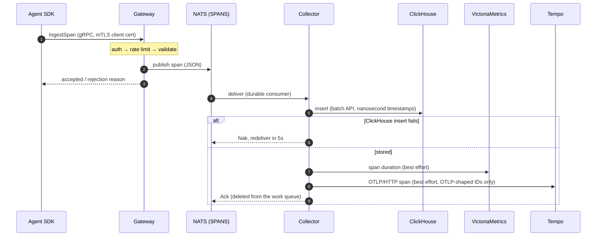

# Architecture

Conduit is three Go services (gateway, collector and UI) and two SDKs (Go
and Python), built on NATS JetStream, ClickHouse, VictoriaMetrics and Grafana
Tempo. This document describes how data moves through the system, what each
component guarantees, and how the data is stored.

## Components

| Component | Source | Role |
|-----------|--------|------|
| **SDKs** | `sdk/go`, `sdk/python` | Create spans in the agent process and send them to the gateway over gRPC with mTLS |
| **Gateway** | `cmd/gateway` | Authenticates agents, validates spans, rate-limits each agent and publishes to NATS |
| **Collector** | `cmd/collector` | Consumes from NATS and writes to ClickHouse (required), VictoriaMetrics and Tempo (both best-effort) |
| **UI** | `cmd/ui` | Server-rendered trace list and trace detail, read from ClickHouse, with sign-in |
| NATS JetStream | | A durable buffer between ingestion and storage. Spans, logs and metrics use separate work-queue streams (`SPANS`, `LOGS`, `METRICS`), so a backlog in one never blocks the others. |
| ClickHouse | | The system of record for spans, LLM data and trace rollups |
| VictoriaMetrics | | Agent metrics (the system of record for them) and span duration metrics |
| Tempo | | A copy of each trace, in OTLP format, for Grafana |

## Data flow

1. **SDK.** Spans are created in the agent process. Trace and span IDs are
   sized to the W3C and OTLP standards: 16-byte trace IDs and 8-byte span IDs.
   Context propagates through `context.Context` in Go and through
   `contextvars` in Python, so nesting is correct across goroutines,
   threads and asyncio tasks. Sending is synchronous, one RPC per span.
2. **Gateway.** Handles each request in this order:
   - **Authenticate** the TLS 1.3 client certificate against the configured
     CA. The agent's identity is the certificate's CommonName.
   - **Rate-limit** with a token bucket per identity, charged per telemetry
     item.
   - **Validate** the span, including ID charset and size, name, status,
     timestamps, attribute limits and LLM field bounds.
   - **Publish** to the `SPANS` stream.

   The wire API is Conduit's own protobuf `IngestionService`
   (`proto/ingestion.proto`), not OTLP.
3. **NATS JetStream.** A work queue: each span is deleted once the
   collector acknowledges it, and the stream has a 7-day maximum age as a
   backstop.
4. **Collector.** At-least-once delivery into ClickHouse. A failed insert is
   retried after a 5-second delay, and a message that can't be decoded is
   discarded for good. Writes to VictoriaMetrics and Tempo are best-effort:
   their failures are logged, not retried, so they can never duplicate rows
   in ClickHouse.
5. **UI.** Reads only from ClickHouse:
   - **Trace list:** the queries are always bounded by a time window, and
     paging uses a keyset cursor.
   - **Trace detail:** capped at 2000 spans per trace.
   - **Sign-in:** a login form with signed session cookies, or Google Cloud
     IAP.

## Delivery and failure behavior

| Failure | Effect |
|---------|--------|
| The gateway rejects a span (invalid, over the rate limit, unauthenticated) | The SDK gets an error. `Span.End` / `span.end()` raises or returns it, with the reason. |
| NATS is unavailable | The gateway fails the publish and returns an error to the SDK. Its `/readyz` reports `nats: unavailable`. |
| ClickHouse is unavailable | The collector naks, NATS keeps the span, and it's redelivered every 5 seconds until ClickHouse returns, for up to 7 days. |
| VictoriaMetrics or Tempo is unavailable | Logged. The span is still stored in ClickHouse. |
| A collector instance restarts | The durable consumer resumes, and unacknowledged spans are redelivered. |

The SDKs don't retry. A failed send is reported to the caller, who decides
what to do.

## Storage schema

### Schema management

The schema is defined by numbered migrations in
`internal/storage/migrations/`, which are embedded in the binaries.
- **Who applies them:** the collector, at startup, before it reconciles
  retention. `collector migrate` does the same and exits, for running as a
  Job before a rollout. The UI never changes the schema.
- **Bookkeeping:** applied versions are recorded in `schema_migrations` with
  a SHA-256 checksum. If a migration is edited after it was applied, or the
  database has a version the binary doesn't know, the collector refuses to
  start.
- **Idempotency:** ClickHouse has no DDL transactions or locks, so every
  migration must be idempotent (`IF NOT EXISTS` / `IF EXISTS`), and a test
  enforces it. That makes it safe for two collectors to start at once.
- **Existing installs:** these adopt migrations automatically. Migration
  0001 is the original DDL, so it applies as a no-op and is recorded.

### ClickHouse `spans`

| Column | Type | Notes |
|--------|------|-------|
| `trace_id`, `span_id`, `parent_id` | `String` | `parent_id` is empty for root spans |
| `agent_name` | `String` | Always the mTLS CommonName, never a client-supplied value |
| `span_name` | `String` | |
| `start_time`, `end_time` | `DateTime64(9, 'UTC')` | Nanosecond precision, written with the native batch protocol |
| `duration_ms` | `UInt64` | |
| `status` | `Enum8('ok', 'error', 'unset')` | |
| `attributes` | `Map(String, String)` | Includes `error.message` for failed spans |
| `llm_model`, `llm_prompt`, `llm_completion` | `Nullable(String)` | Set only on LLM spans |
| `llm_input_tokens`, `llm_output_tokens` | `Nullable(UInt32)` | |
| `llm_cost_usd` | `Nullable(Float64)` | |
| `ingested_at` | `DateTime` | Defaults to `now()` |

The table is a `MergeTree`, partitioned by day and ordered by
`(agent_name, trace_id, start_time)`. Rows expire after
**`SPAN_RETENTION_DAYS`** (default 90, range 1–3650).
- **Who sets it:** the collector owns retention, as part of owning the schema. On startup it compares the
  table's TTL with the setting and runs `ALTER TABLE spans MODIFY TTL …`
  only if they differ. Shortening retention lets ClickHouse delete rows
  that are now past it.
- **The UI** only creates the tables if they're missing, and never alters
  them.

### ClickHouse `logs`

Log records sent in `IngestBatch`. Each is validated at the gateway: the
severity enum, a body of 1 byte to 32 KiB, a timestamp no more than an hour
in the future, well-formed optional `trace_id` and `span_id` (a span needs
a trace), and the shared attribute limits. Agent identity comes from the
certificate, as for spans.

| Column | Type | Notes |
|--------|------|-------|
| `timestamp` | `DateTime64(9, 'UTC')` | Defaults to the receive time if the client sends none |
| `agent_name` | `String` | The mTLS CommonName |
| `severity` | `Enum8('unspecified', 'debug', 'info', 'warn', 'error')` | |
| `body` | `String` | |
| `attributes` | `Map(String, String)` | |
| `trace_id`, `span_id` | `String` | Empty unless the log belongs to a trace or span |

The table is partitioned by day and ordered by `(agent_name, timestamp)`.
`SPAN_RETENTION_DAYS` applies to it as well.

### VictoriaMetrics: agent metrics

Gauges and counters sent in `IngestBatch` are written to VictoriaMetrics.
The gateway validates them:
- **Names** must be valid Prometheus names. `conduit_*` is reserved for
  Conduit's own series, so agents can't forge them, and `__*` is reserved
  too.
- **Labels:** at most 32, with Prometheus-style keys and values of at most
  1 KiB.
- **Values** must be finite, and counters must be ≥ 0.
- **The `agent` label** is always set from the certificate.

For metrics, VictoriaMetrics is the system of record, so a failed write is
retried, unlike the best-effort span-duration export. Label values are
escaped for the Prometheus text format (backslash, quote and newline), so a
value can't inject extra samples.

### ClickHouse `trace_summary`

A materialized view (`AggregatingMergeTree`) with per-trace rollups: start,
end, span count, error count, tokens and cost. It uses `SimpleAggregateFunction`
columns, so rows from separate inserts merge correctly. Query it with the
matching aggregate functions and `GROUP BY trace_id`. Nothing in the UI
reads it yet.

### What the UI reads

| Query | Bounded by |
|-------|-----------|
| Trace list | A time window (1h, 24h or 7d), up to 100 traces per page, keyset paging |
| Trace detail | Up to 2000 spans, ordered by start time |
| Agent suggestions | A time window, up to 200 names |

The UI never reads prompts or completions. See [Roadmap: open decisions](roadmap.md#open-decisions).

## Sensitive data

By default, prompts and completions are stored in ClickHouse whenever an SDK
records them with `RecordLLMCall` / `record_llm_call`.

**To never store them, set `STORE_LLM_PAYLOADS=false` on the gateway.**
- **What's dropped:** prompts and completions are removed at the gateway,
  before anything is published to NATS, logged or stored.
- **What's kept:** the model, token counts and cost are always kept.
- **Validation:** a span whose prompt would have been too large is still
  accepted, because the prompt is dropped before validation.
- **Typos:** an unrecognized value stops the gateway at startup, rather
  than silently storing payloads.

With storage on, treat ClickHouse access as access to prompt data.
Payloads already stored aren't removed when you turn the switch off.

## Operational endpoints

Every service exposes `/livez` and `/readyz`. The gateway and collector serve
them on `HEALTH_ADDR` (default `:8081`); the UI serves them on its main port.
See [Deployment: health checks](deployment.md#health-checks).

## Design decisions

- **Separate health port for the gateway.** Its gRPC port requires mTLS
  client certificates, which Kubernetes and compose probes can't present.
- **Generated code is committed.** The Go and Python protobuf stubs are in
  the repository, so a checkout builds with nothing but Go. CI fails if
  they drift from the `.proto` files.
- **No JavaScript framework.** The UI uses `html/template`, htmx and two
  small scripts, all embedded in the binary. Its strict CSP rules out
  inline scripts and styles.
- **ClickHouse as the system of record.** Only ClickHouse failures trigger
  redelivery. Treating the other sinks as best-effort keeps duplicate rows
  out of ClickHouse.
